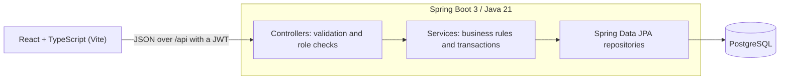

# Smart Inventory & Business Management System

A full-stack inventory and order management system for a small trading business, built with **Java 21, Spring Boot 3, PostgreSQL and React**. It tracks stock, raises low-stock alerts, manages customers and suppliers, processes orders through their lifecycle, and reports on sales.

The demo data models a South African building and hardware supplier (prices in ZAR, 15% VAT).


## Features

| Area | What it does |
| --- | --- |
| **Inventory** | Products with SKU, category, supplier, cost and selling price, unit, reorder level. Search, filter, sort and paginate. Products with sales history are archived instead of deleted. |
| **Stock tracking** | Every quantity change is a recorded *stock movement* (stock in, stock out, stock take) with who did it, why, and the before/after quantity. Quantities can't be edited directly, so there is always an audit trail. |
| **Low-stock alerts** | Products at or below their reorder level are flagged on the dashboard, in the top bar and sidebar, and in a downloadable reorder list that includes supplier contact details. |
| **Customers & suppliers** | Full CRUD, search, order counts per customer, product counts per supplier. Records in use can't be deleted. |
| **Order processing** | Pending → Confirmed → Shipped → Delivered, or Cancelled. Stock is checked on creation, **deducted on confirmation**, and **returned if a confirmed order is cancelled**. Prices are captured at order time; VAT is calculated server-side. Printable order view. |
| **Admin dashboard** | Reorder list, orders awaiting confirmation, monthly revenue chart, orders by status, recent orders, best sellers, stock value. |
| **Authentication** | Stateless JWT login, BCrypt passwords, three roles enforced on every endpoint. |
| **Reporting** | Sales summary for any date range (revenue, VAT, average order, daily chart, top products and customers) and CSV exports: full stock list, reorder list, orders. |

### Roles

| Role | Can do |
| --- | --- |
| Admin | Everything, including managing users |
| Manager | Catalogue, categories, suppliers, delete records, reports |
| Staff | View everything except reports; capture orders, customers and stock movements |

## Architecture



**Backend highlights**

- Layered design: controller → service → repository, with DTO records so entities never leak into the API.
- `StockService` is the only code that changes quantities; it writes a `StockMovement` for every change.
- Optimistic locking (`@Version`) on products stops two people overselling the same stock.
- Dynamic search with JPA Specifications; `@EntityGraph` and fetch joins avoid N+1 queries.
- Consistent JSON errors from a global exception handler (400 validation errors include per-field messages).
- Dates bucketed by the business's time zone (`Africa/Johannesburg`), not UTC.
- CSV exports are quoted correctly and guarded against spreadsheet formula injection.
- OpenAPI docs with Swagger UI.
- Unit tests for the order/stock rules (Mockito) and integration tests over the real HTTP layer (MockMvc + H2).

**Frontend highlights**

- React 19 + TypeScript, React Router, Axios with a token interceptor and automatic logout on 401.
- Role-aware navigation and actions; routes lazy-loaded per page.
- Recharts for charts; accessible forms (linked labels, field-level errors), keyboard-friendly dialogs, responsive down to phone width, print styles for orders.

## Project structure

```
smart-inventory/
├── backend/                     Spring Boot API
│   └── src/main/java/com/smartinventory/
│       ├── config/              Security, OpenAPI, demo data seeder
│       ├── security/            JWT service + filter, user details
│       ├── entity/              JPA entities and enums
│       ├── repository/          Spring Data repositories
│       ├── dto/                 Request/response records
│       ├── service/             Business logic
│       ├── controller/          REST endpoints
│       └── common/              Errors, paging, helpers
├── frontend/                    React app
│   └── src/
│       ├── api/                 Axios client, endpoints, types
│       ├── auth/                Auth context
│       ├── components/          Layout, forms, shared UI
│       └── pages/               One file per screen
├── docker-compose.yml
└── .github/workflows/ci.yml
```

## Running it

### Option 1: everything in Docker

Needs Docker Desktop.

```bash
docker compose up --build
```

Open http://localhost:3000. The API is on http://localhost:8080 and Swagger UI on http://localhost:8080/swagger-ui.html.

### Option 2: run locally (best for development)

Needs **Java 21**, **Maven 3.9+** (or IntelliJ, which bundles it), **Node 20+**, and PostgreSQL.

1. **Database.** Either `docker compose up db`, or create it in your own PostgreSQL:
   ```sql
   CREATE USER inventory WITH PASSWORD 'inventory';
   CREATE DATABASE smart_inventory OWNER inventory;
   ```
2. **Backend** (port 8080). Tables are created automatically and demo data is loaded on first start.
   ```bash
   cd backend
   mvn spring-boot:run
   ```
3. **Frontend** (port 5173). Vite forwards `/api` to the backend.
   ```bash
   cd frontend
   npm install
   npm run dev
   ```
4. Open http://localhost:5173 and log in.

### Demo accounts

| Role | Email | Password |
| --- | --- | --- |
| Admin | admin@smartinventory.co.za | Admin@123 |
| Manager | manager@smartinventory.co.za | Manager@123 |
| Staff | staff@smartinventory.co.za | Staff@123 |

The login screen has buttons that fill these in.

### Configuration

| Variable | Default | Purpose |
| --- | --- | --- |
| `DB_URL` | `jdbc:postgresql://localhost:5432/smart_inventory` | Database connection |
| `DB_USERNAME` / `DB_PASSWORD` | `inventory` / `inventory` | Database credentials |
| `JWT_SECRET` | development key | Base64 HMAC key, at least 256 bits. **Change it** for any deployment: `openssl rand -base64 64` |
| `JWT_EXPIRATION_MS` | `28800000` (8 hours) | Token lifetime |
| `CORS_ALLOWED_ORIGINS` | `http://localhost:5173` | Comma-separated front-end origins |
| `SEED_DEMO_DATA` | `true` | Load demo data into an empty database |

### Tests

```bash
cd backend && mvn test          # unit + integration tests (uses in-memory H2, no PostgreSQL needed)
cd frontend && npm run build    # type-check and production build
```

## API overview

All endpoints are under `/api` and need `Authorization: Bearer <token>` except login. Full interactive docs at `/swagger-ui.html`.

| Method | Endpoint | Notes |
| --- | --- | --- |
| POST | `/auth/login` | Returns a JWT and the user |
| GET | `/auth/me` | Current user |
| POST | `/auth/change-password` | |
| GET | `/products?q=&categoryId=&supplierId=&stockStatus=&active=&page=&size=&sort=` | `stockStatus`: `IN_STOCK`, `LOW`, `OUT`, `REORDER` |
| GET | `/products/low-stock` | Low-stock alerts |
| POST / PUT / DELETE | `/products`, `/products/{id}` | Manager+. Delete archives products with orders |
| GET / POST | `/stock-movements` | History (filter by product, type) / record IN, OUT, ADJUSTMENT |
| GET / POST | `/orders` | Search / create (pending) |
| GET | `/orders/{id}` | With line items |
| PATCH | `/orders/{id}/status` | Moves through the lifecycle, adjusts stock |
| DELETE | `/orders/{id}` | Manager+, pending or cancelled only |
| CRUD | `/customers`, `/suppliers`, `/categories` | |
| GET | `/dashboard` | Everything the dashboard shows, in one call |
| GET | `/reports/sales-summary?from=&to=` | Manager+ |
| GET | `/reports/inventory.csv`, `/reports/low-stock.csv`, `/reports/sales.csv?from=&to=` | Manager+ |
| CRUD | `/users` | Admin only |

## Screenshots

| | |
| --- | --- |
|  |  |
|  |  |

## Ideas for next steps

- Flyway migrations instead of `ddl-auto=update`
- Purchase orders to suppliers, generated from the reorder list
- Email or WhatsApp alerts when stock hits its reorder level
- Barcode scanning for stock takes
- Refresh tokens and an audit log of user actions
- Deploy (e.g. Render or Railway for the API + Neon for PostgreSQL + Vercel for the front end)
