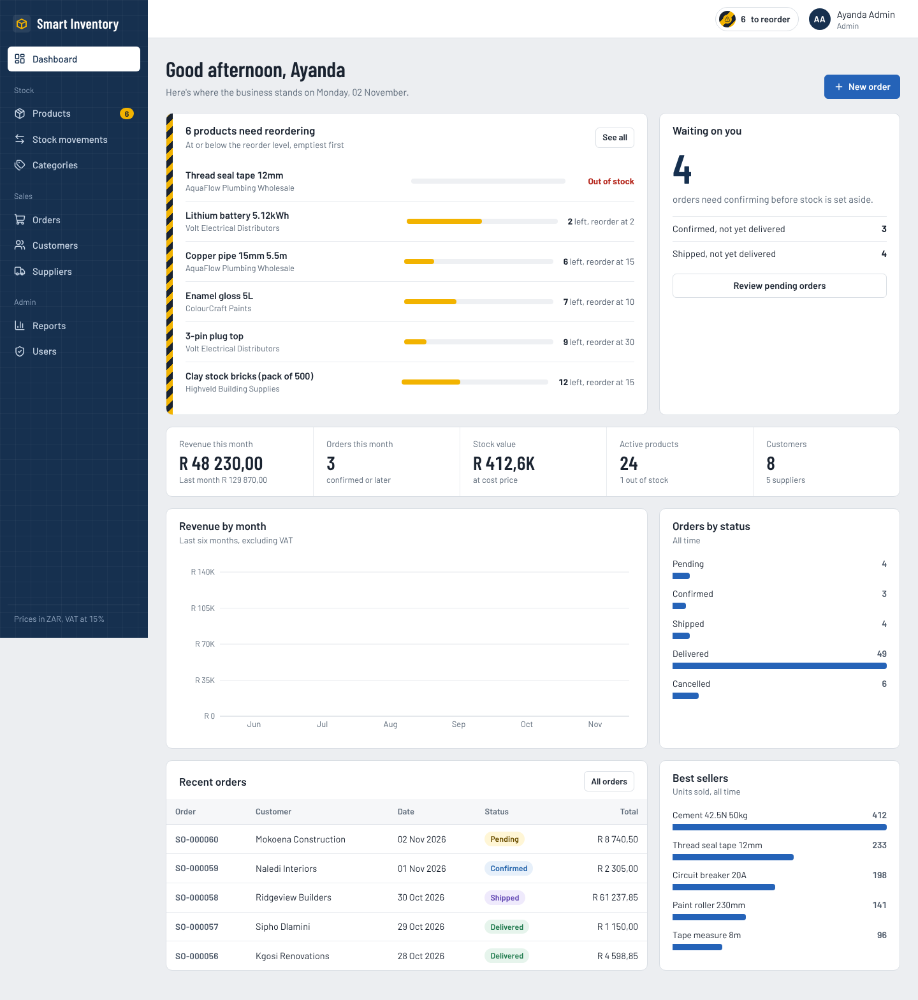
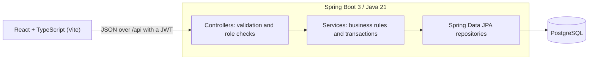
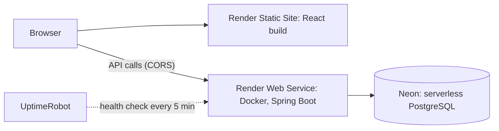
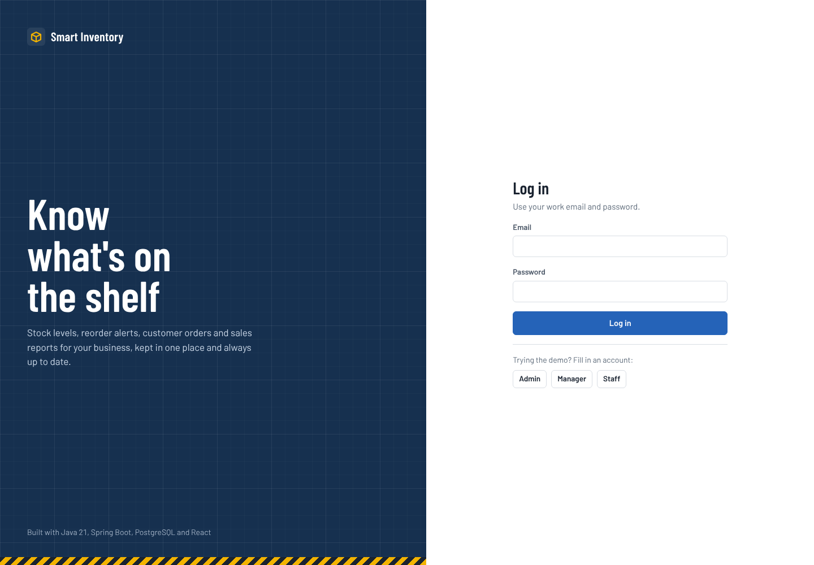
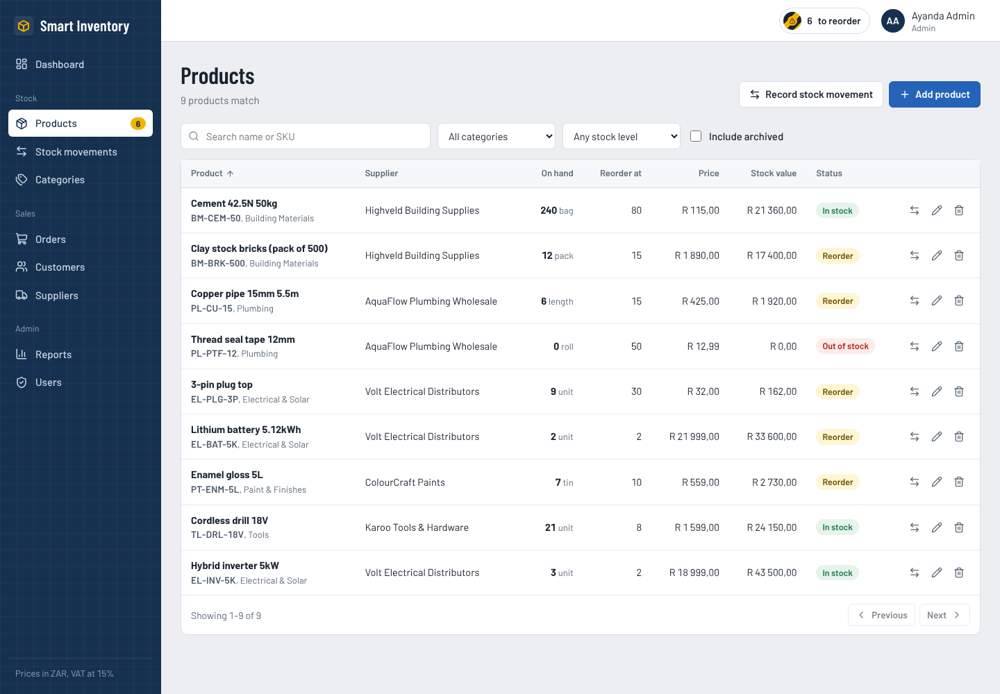
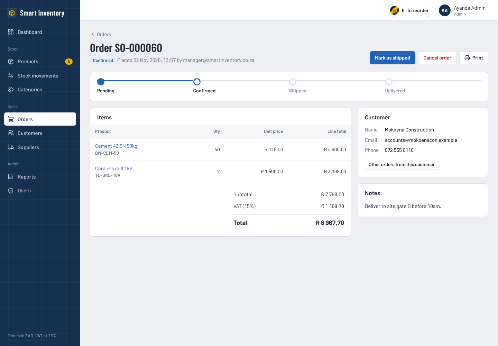
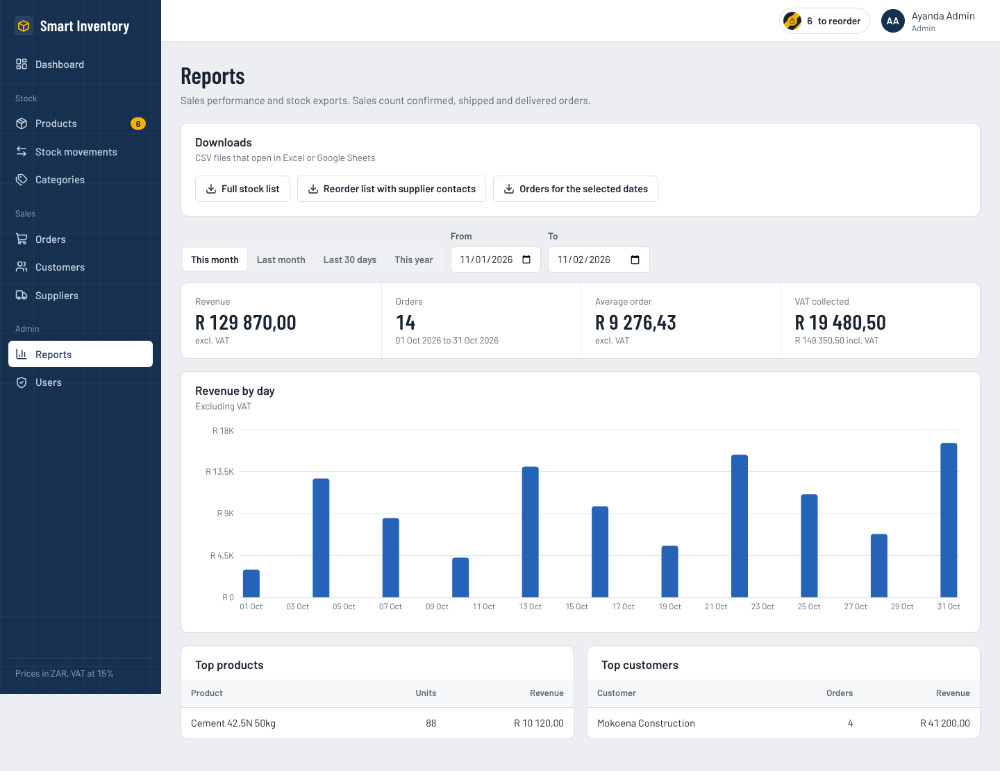

# Maroka Smart Inventory

A full-stack inventory and business management system for a small trading business, built with **Java 21, Spring Boot 3, PostgreSQL and React (TypeScript)**. It tracks stock, raises low-stock alerts, manages customers and suppliers, takes orders through their lifecycle, and reports on sales, with role-based rules that reflect how a real business separates duties.

The sample data models a South African building and hardware supplier (prices in ZAR, 15% VAT).

### 🔗 [Live demo](https://maroka-inventory-system-1.onrender.com)

Open the link and pick a role on the login page. No sign-up needed.

| Role | Email | Password |
| --- | --- | --- |
| Admin | admin@demo.example | Admin@123 |
| Manager | manager@demo.example | Manager@123 |
| Staff | staff@demo.example | Staff@123 |

The demo runs on sample data that **resets every night at 03:00 (SAST)**, so feel free to create orders, add customers or record stock. Try logging in as different roles to see how the permissions change. Hosted on free plans, so the very first load can take a few seconds.



## Features

| Area | What it does |
| --- | --- |
| **Inventory** | Products with SKU, category, supplier, cost and selling price, unit and reorder level. Search, filter, sort and paginate. Products with sales history are archived instead of deleted. |
| **Stock tracking** | Every quantity change is a recorded *stock movement* (stock in, stock out, stock take) with who did it, why, and the before and after quantity. Quantities can't be edited directly, so there is always an audit trail. |
| **Low-stock alerts** | Products at or below their reorder level are flagged on the dashboard, in the top bar and sidebar, and in a downloadable reorder list with supplier contact details. |
| **Customers and suppliers** | Search, order counts and product counts. Customer contact details are required, validated and normalised, duplicates are rejected, and each customer records which staff member added them. |
| **Order processing** | Pending → Confirmed → Shipped → Delivered, or Cancelled. Stock is checked when the order is captured, **deducted on confirmation** and **returned if a confirmed order is cancelled**. Prices are captured at order time and VAT is calculated on the server. Printable order view. |
| **Dashboard** | Reorder list, orders awaiting confirmation, monthly revenue chart, orders by status, recent orders, best sellers and stock value. |
| **Security** | Stateless JWT login, BCrypt password hashing, a strong-password policy, and role checks on every endpoint. |
| **Reporting** | Sales summary for any date range (revenue, VAT, average order, daily chart, top products and customers) and CSV exports: full stock list, reorder list and orders. |

### Roles

The permissions follow **separation of duties** and **least privilege**: nobody can both capture and approve the same order, and personal customer data can only be changed by one trusted role.

| Role | Can do |
| --- | --- |
| **Staff** | Capture orders, add customers, record stock movements, cancel pending orders. The front line that customers call. |
| **Manager** | Confirm orders (which commits stock), manage products, categories and suppliers, view reports, and see which staff member added each customer. |
| **Admin** | Manage user accounts and edit or delete customer records, plus everything a manager can do. |

Why it's split this way:

- **Only managers and admins confirm orders.** Confirming deducts stock, so the person who captures an order can't also approve it.
- **Only admins edit or delete customers.** Staff need to add customers to take orders, but limiting changes to personal data to one role reduces the chance of misuse (in the spirit of POPIA).
## Engineering decisions

| Decision | Reason |
| --- | --- |
| Layered architecture (controller → service → repository) with DTO records | Business rules live in one place, and database entities never leak into the API |
| `StockService` is the only code that changes quantities | Every change writes a `StockMovement`, so the audit trail can't be bypassed |
| Optimistic locking (`@Version`) on products | Stops two people selling the last unit at the same time |
| Order confirmation and cancellation run in transactions | Stock and order status always change together, or not at all |
| Validation and normalisation on the server | The browser can be bypassed. Phone numbers are stored in one format (`0XX XXX XXXX`), so duplicate checks actually work |
| One shared password rule (`PasswordRules`) | The same policy for creating users, resetting and changing passwords, with a live checklist in the UI |
| Demo mode behind a configuration flag | Demo accounts, sample data and the nightly reset exist only when `DEMO_MODE=true`, on a separate database. The real system never contains them |
| All secrets in environment variables | Nothing sensitive is committed to the repository |

**Development approach:** built iteratively in an Agile way, keeping a prioritised feature backlog and delivering and testing one small increment at a time. Requirements were refined as business rules came up (for example, moving order confirmation to managers only).

## Architecture



**Deployment (live demo)**



**Backend highlights**

- Dynamic search with JPA Specifications; `@EntityGraph` and fetch joins avoid N+1 queries.
- Consistent JSON errors from a global exception handler (validation errors include per-field messages).
- Dates bucketed by the business's time zone (`Africa/Johannesburg`), not UTC.
- CSV exports are quoted correctly and guarded against spreadsheet formula injection.
- Scheduled job (`@Scheduled`) that wipes and reseeds the demo database every night.
- OpenAPI docs with Swagger UI.
  **Frontend highlights**

- React 19 + TypeScript, React Router, Axios with a token interceptor and automatic logout on 401.
- Role-aware navigation and actions; routes lazy-loaded per page.
- Recharts for charts; accessible forms (linked labels, field-level errors), keyboard-friendly dialogs, responsive down to phone width, print styles for orders.
## Testing

**16 automated tests:**

- **Unit tests** (JUnit 5 + Mockito) for the order and stock rules: stock is checked, deducted and returned correctly, and staff can't confirm orders.
- **Integration tests** (MockMvc + H2) over the real HTTP layer: login, role restrictions, validation errors, and demo accounts that even an admin can't delete.
```bash
cd backend && mvn test          # unit + integration tests (in-memory H2, no PostgreSQL needed)
cd frontend && npm run build    # type-check and production build
```

## Project structure

```
smart-inventory/
├── backend/                     Spring Boot API
│   └── src/main/java/com/smartinventory/
│       ├── config/              Security, OpenAPI, demo data seeder
│       ├── security/            JWT service + filter, user details
│       ├── entity/              JPA entities and enums
│       ├── repository/          Spring Data repositories
│       ├── dto/                 Request/response records
│       ├── service/             Business logic
│       ├── controller/          REST endpoints
│       └── common/              Errors, paging, password rules
├── frontend/                    React app
│   └── src/
│       ├── api/                 Axios client, endpoints, types
│       ├── auth/                Auth context
│       ├── components/          Layout, forms, shared UI
│       └── pages/               One file per screen
├── docker-compose.yml
└── .github/workflows/ci.yml
```

## Running it locally

Needs **Java 21**, **Maven 3.9+** (or IntelliJ, which bundles it), **Node 20+** and PostgreSQL.

1. **Database.** Either `docker compose up db`, or create it in your own PostgreSQL:
```sql
   CREATE USER inventory WITH PASSWORD 'inventory';
   CREATE DATABASE smart_inventory OWNER inventory;
```
2. **Backend** (port 8080). Tables are created automatically. Set `DEMO_MODE=true` to load the sample data and demo accounts.
```bash
   cd backend
   DEMO_MODE=true mvn spring-boot:run
```
3. **Frontend** (port 5173). Vite forwards `/api` to the backend.
```bash
   cd frontend
   npm install
   npm run dev
```
4. Open http://localhost:5173 and pick a role on the login page.
   Or run everything in Docker with `docker compose up --build` and open http://localhost:3000.

### Configuration

| Variable | Default | Purpose |
| --- | --- | --- |
| `DB_URL` | `jdbc:postgresql://localhost:5432/smart_inventory` | Database connection |
| `DB_USERNAME` / `DB_PASSWORD` | `inventory` / `inventory` | Database credentials |
| `JWT_SECRET` | development key | Base64 HMAC key, at least 256 bits. **Use your own** for any deployment: `openssl rand -base64 64` |
| `JWT_EXPIRATION_MS` | `28800000` (8 hours) | Token lifetime |
| `CORS_ALLOWED_ORIGINS` | `http://localhost:5173` | Comma-separated frontend origins |
| `DEMO_MODE` | `false` | Demo only: loads sample data, lists demo accounts on the login page, protects them, and resets nightly. **Never enable on a real business's database.** |
| `DEMO_RESET_CRON` | `0 0 3 * * *` | When the demo resets (03:00 daily) |
| `VITE_API_URL` (frontend) | `/api` | Backend address when the frontend is hosted separately |

## API overview

All endpoints are under `/api` and need `Authorization: Bearer <token>`, except login and demo info. Full interactive docs at `/swagger-ui.html`.

| Method | Endpoint | Notes |
| --- | --- | --- |
| POST | `/auth/login` | Returns a JWT and the user |
| GET | `/auth/demo` | Public. Whether demo mode is on, and the demo accounts |
| GET | `/auth/me` | Current user |
| POST | `/auth/change-password` | |
| GET | `/products?q=&categoryId=&supplierId=&stockStatus=&active=&page=&size=&sort=` | `stockStatus`: `IN_STOCK`, `LOW`, `OUT`, `REORDER` |
| GET | `/products/low-stock` | Low-stock alerts |
| POST / PUT / DELETE | `/products`, `/products/{id}` | Manager and Admin. Delete archives products with orders |
| GET / POST | `/stock-movements` | History (filter by product, type) / record IN, OUT, ADJUSTMENT |
| GET / POST | `/orders` | Search / capture (pending) |
| GET | `/orders/{id}` | With line items |
| PATCH | `/orders/{id}/status` | Moves through the lifecycle and adjusts stock. Confirming needs Manager or Admin |
| DELETE | `/orders/{id}` | Manager and Admin, pending or cancelled only |
| GET / POST | `/customers` | Search / add (Staff) |
| PUT / DELETE | `/customers/{id}` | Admin only |
| CRUD | `/suppliers`, `/categories` | Changes need Manager or Admin |
| GET | `/dashboard` | Everything the dashboard shows, in one call |
| GET | `/reports/sales-summary?from=&to=` | Manager and Admin |
| GET | `/reports/inventory.csv`, `/reports/low-stock.csv`, `/reports/sales.csv?from=&to=` | Manager and Admin |
| CRUD | `/users` | Admin only |

## Screenshots

| | |
| --- | --- |
|  |  |
|  |  |

## Roadmap

- Account lockout after 5 failed login attempts
- Staff performance view for managers (orders captured per staff member)
- Flyway migrations instead of `ddl-auto=update`
- Purchase orders to suppliers, generated from the reorder list
- Email or WhatsApp alerts when stock reaches its reorder level
